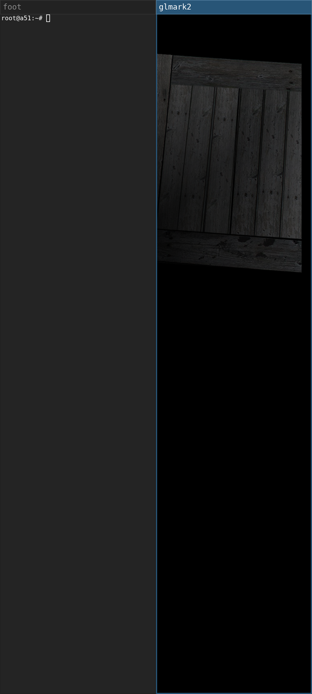

# Linux on the Samsung Galaxy A51 (SM-A515F)

Mainline Linux support for the Samsung Galaxy A51, an Exynos 9611 phone.
It boots into a full GPU-composited desktop: the kernel owns the display
controller, the MIPI link and the AMOLED panel, the Mali-G72 runs under
panfrost, and touchscreen, thermal sensors and the charger are all driven by
mainline drivers.  Wi-Fi station mode works as well, including WPA3, and
the same block now carries a working Bluetooth HCI transport.  The ABOX
audio DSP boots under its SysMMU and accepts BT SCO enable requests, but
there is no host sound card yet.


*Weston with Xwayland: `htop` is an X11 client, the window next to it is a
native Wayland one, both composited on the GPU at 60 fps on the 1080x2400
panel.*

## Screenshots

| Sway | Phosh |
|---|---|
|  |  |
| *Sway tiling `foot` next to `glmark2`, rendering a textured scene on the Mali-G72 through panfrost.* | *Phosh on the phone, with the blurred, translucent shell drawn by the GPU.* |


## Hardware

| | |
|---|---|
| SoC | Samsung Exynos 9611: 4x Cortex-A53 + 4x Cortex-A73, Mali-G72 MP3 |
| RAM | 6 GB |
| Display | 6.5" 1080x2400 AMOLED (Samsung EA8076), MIPI DSI, command mode |
| Storage | UFS (Android), microSD |
| Wi-Fi/Bluetooth | Samsung SCSC ("mx140") over HIP4, 2.4 and 5 GHz |
| Power | Samsung SM5713 charger, fuel gauge and MUIC, S2MPU09 PMIC |
| Input | Melfas mss100 touchscreen, GPIO keys |

## Status

Working:

- **Display** - DECON/IDMA/DPP scanout, DSIM host and D-PHY, panel bridge,
  brightness, DPMS, s2idle. 60 fps with vblank-driven page flips.
- **GPU** - panfrost on the Mali-G72, with a g3d power domain that gates the
  GPU through the vendor PMU sequences and TZPC SMC, and an 11-point
  DVFS ladder from 260 to 1053 MHz backed by the BUCK5 `vdd_g3d` rail.
  The OPP voltages are this chip's calibrated G3D ASV values, read from the
  vendor kernel's `asv_table` (260 MHz at 581.25 mV, 1053 MHz at 993.75 mV).
  The GPU is also a devfreq cooling device, using the vendor 80-115 C trip
  ladder to cap it at 764, 572, 455, 338 and 260 MHz.
- **CPU DVFS** - both clusters scale through the mainline `exynos9610-cpuclk`
  driver (403-1742 MHz LITTLE, 936-2314 MHz big, `schedutil`), with the
  cluster PLLs and S2MPU09 BUCK2/BUCK3 rails programmed over ACPM.
- **Touchscreen and keys** - mss100 multi-touch, power and volume keys.
- **Thermal** - Exynos 9610 TMU with eFuse trim calibration; separate GPU,
  CPU-cluster and aggregate zones, with `step_wise` cooling.
- **Charger** - input current limit, fast-charge current, float voltage and a
  charge-stop threshold with hysteresis.
- **USB** - DWC3 peripheral mode, used here as an ECM gadget (the root
  filesystem runs over it).
- **Storage** - microSD in SDR104 (100 MHz, 4-bit, 1.8 V), UFS.
- **Wi-Fi** - station mode on 2.4 and 5 GHz, WPA2-PSK and WPA3-SAE, DHCP,
  and a join at boot with a saved connection.  ~90 Mbps on the LAN,
  ~47 Mbps down and 36-42 Mbps up to the internet.
- **Bluetooth** - BSMHCP HCI transport, LE and BR/EDR discovery, LE
  advertising, LE Secure Connections pairing and bonds, and ACL data.
  BlueZ powers the adapter at boot; no manual `hciconfig` step is needed.
- **ABOX bring-up** - the DISPAUD power domain, CMU_DISPAUD PLL and bus
  clocks, the ABOX Cortex-A7 firmware, GIC/IPC mailbox and the ABOX
  SysMMU.  Firmware, private, SFR and VSS windows are mapped; WLBT's BT
  SCO buffer is mapped at IOVA `0xb0000000` and SCO enable succeeds in
  both directions.  There is no PCM/RDMA/WDMA path or ALSA card yet.
- **Desktops** - Weston with Xwayland, Sway, Phosh and KDE Plasma Mobile all
  render on the panel.

Not supported yet:

- **CPU idle / deep sleep** - needs the PMUCAL core power down/up sequences;
  only s2idle works.
- **USB host / OTG** - the controller is fixed to peripheral mode. The boost
  and MUIC switching are in place, the role switch is not wired up yet.
- **Audio (ABOX PCM)** - the DSP boots and BT SCO can be enabled, but the
  PCM/RDMA/WDMA path, UAIF/codec routing and a host ALSA card are not
  implemented.  Bluetooth SCO/HFP audio and AVDTP coexistence detection
  are therefore not functional; A2DP playback over the ACL transport works
  when a media session is running.
- Cameras, modem and NFC - untouched subsystems.

## Wi-Fi

The A51 has no SDIO or PCIe wireless interface: Wi-Fi and Bluetooth sit
behind Samsung's SCSC ("mx140") block, which the host drives through a HIP4
queue pair in DRAM and a mailbox.  `CONFIG_EXYNOS9610_WLBT` builds
`exynos9610-wlbt.ko` from six translation units under
`drivers/soc/samsung/` (core, HIP4, MLME, debugfs, netdev and BT).

On this port the module copies the firmware into the peer's MIF window
itself, so `load_firmware=1` is required.  The three files the module asks
for have to be in place (they come from the vendor partition):

```sh
install -D -m 0644 mx140.bin          /lib/firmware/mx140/mx140.bin
install -D -m 0644 mx140_wlan.hcf     /lib/firmware/mx140/mx140_wlan.hcf
install -D -m 0644 mx140_wlan_sw.hcf  /lib/firmware/mx140/mx140_wlan_sw.hcf
```

and the module has to be told to load them:

```sh
# /etc/modprobe.d/wlbt.conf
options exynos9610_wlbt send_pmk=0 eapol_mlme=1 rx_chain_frame=1 load_firmware=1 sae_support=1
```

`send_pmk=0` keeps the four-way handshake in the supplicant: the peer's
`SET_PMK` path can reset its firmware.  `eapol_mlme=1` is the EAPOL path that
gets message 2 past the peer's key gate, and `rx_chain_frame=1` takes a frame
out of a received chain (needed for the SAE indications).  `sae_support` is
off at boot because advertising WPA3 changes what the peer does on every
boot, and one failed join would then repeat forever.  WPA2 does not need it;
turn it on for a WPA3 network.

Measured on the SM-A515F with 6.18.58, against a 5 GHz access point on
channel 64:

| test | result |
| --- | --- |
| `wpa_cli -i wlan0 status` | `wpa_state=COMPLETED`, `key_mgmt=SAE`, `mgmt_group_cipher=BIP` |
| DHCP address | `192.168.100.78/24` |
| ping | 33-36 ms |
| LAN download | 10-11.5 MB/s (~90 Mbps) |
| internet download | ~47 Mbps |
| internet upload | 36-42 Mbps |
| kernel log during a bulk transfer | 0 lines |
| cold boot | joins with a saved connection, 0 firmware resets |

Throughput was measured with `curl --interface wlan0` against a host HTTP
server on the LAN and against an internet speed-test endpoint; the USB
gadget carries the root filesystem, so naming the interface matters.

For WPA3, the access point used here never answers the SAE H2E exchange;
`sae_pwe=0` (hunting-and-pecking) is what completes:

```ini
# /etc/wpa_supplicant/wpa_supplicant-wlan0.conf
sae_pwe=0
network={
        ssid="..."
        psk="..."
        key_mgmt=SAE
        ieee80211w=1
}
```

WPA2-PSK uses the same driver with `key_mgmt=WPA-PSK` and no `sae_pwe`.

Limitations:

- If the first join after boot does not finish within about a minute, the
  firmware can assert its watchdog and stop.  A warm reboot leaves the
  companion in that state; a cold boot clears it.
- Only station mode has been exercised.

## Bluetooth

Bluetooth is a separate SCSC service (`SCSC_SERVICE_ID_BT = 2`), not an HCI
UART or a HIP4 queue.  `wlbt-bt.c` starts that service through the
service-management channel, lays out the BHCS and BSMHCP shared-memory block,
and registers a virtual HCI device.  Command, event and ACL rings are bridged
to the HCI core; ACL TX buffers are reclaimed from the BSMHCP free ring and
turned into Number Of Completed Packets credits.

The firmware file is `mx140/mx140_bt.hcf` and must be next to the Wi-Fi
firmware.  The Bluetooth core is built in (`CONFIG_BT=y`,
`CONFIG_BT_BREDR=y`, `CONFIG_BT_LE=y`, `CONFIG_BT_LE_L2CAP_ECRED=y`), and
`/etc/modules-load.d/wlbt.conf` loads `exynos9610_wlbt.ko` at boot.

Secure Connections also needs the default DRBG and the ECDH helpers.  The
current kernel builds `CONFIG_CRYPTO_RNG_DEFAULT`, `CONFIG_CRYPTO_DRBG`,
`CONFIG_CRYPTO_JITTERENTROPY`, `CONFIG_CRYPTO_ECDH` and `CONFIG_CRYPTO_ECC`
in, so no extra module is needed.  On an older build where these are
modules, install and load `drbg.ko`; without it `generate_ecdh_keys()`
fails, the phone never sends its P-256 public key, and the host logs
`Pairing Failed` with reason `Unspecified (0x08)`.

The address is read at probe time from `mx140/bt_addr`, an ASCII file copied
from the Android `efs` partition (`/bluetooth/bt_addr`).  The SM-A515F file
contains `C0:D2:DD:24:44:94`.  `bt_addr=` overrides it; if the file is missing
the driver keeps a placeholder and warns.

The audio graph starts at boot as the root user.  Debian's PipeWire and
WirePlumber user units carry `ConditionUser=!root`, and WirePlumber's default
profile waits for a logind seat to become active.  This port has neither a
non-root session nor an active seat at boot, so the units need these drop-ins:

```sh
# /etc/systemd/user/pipewire.service.d/root.conf
# /etc/systemd/user/pipewire-pulse.service.d/root.conf
# /etc/systemd/user/wireplumber.service.d/root.conf
[Unit]
ConditionUser=
```

```sh
# /etc/systemd/user/wireplumber.service.d/embedded.conf
[Service]
ExecStart=
ExecStart=/usr/bin/wireplumber -p main-embedded
```

Then enable the root session's units and lingering:

```sh
loginctl enable-linger root
systemctl --user enable --now pipewire pipewire-pulse wireplumber
```

The `main-embedded` profile disables seat monitoring, so the BlueZ monitor
registers A2DP sink/source, AVRCP and HFP without a logind seat.

Verified on the SM-A515F:

| test | result |
| --- | --- |
| `hciconfig -a` | `UP RUNNING`, HCI 5.0, manufacturer 117 (Samsung) |
| `bluetoothctl --timeout 5 scan on` | LE advertisers and the Samsung TV over BR/EDR |
| `bluetoothctl advertise on` | one active advertising instance |
| host `bluetoothctl pair` over BR/EDR | `Pairing successful`; both sides bonded and trusted |
| host SDP stress over BR/EDR | 80/80 requests on one link; 200/200 while 40 LE GATT reads ran |
| host A2DP stream to phone | 6 s host stream; phone `bluez_input...` → Dummy Output `RUNNING`, no Bluetooth errors |
| cold boot, host reconnect, A2DP stream | services active, bond and profiles persist, phone sink `RUNNING` |
| host LE link, 80 GATT reads | 80 `Device Name` responses on one connection, no ACL stall |
| host LE Secure Connections pair | `Pairing successful`; both P-256 public keys and DHKey checks present, AES-CCM encryption enabled, bond saved |
| host LE reconnect with saved bond | existing SC bond reconnects without re-pairing |
| reboot, host LE link, 40 GATT reads | 40 responses; address, bond and HCI startup persist |
| three `hciconfig hci0 down` / `up` cycles | adapter returns to `UP RUNNING` each time |
| reboot with WPA3 AP | Bluetooth and Wi-Fi both come up hands-free |
| cold boot, ABOX firmware | `ABOX boot done`, firmware version `0x1` |
| ABOX SysMMU | version `0x7040000f`, control `0x5` |
| BT SCO enable/disable, speaker and microphone | `ret=0` in both directions |

### ABOX and Bluetooth SCO

`exynos9610-abox.ko` is the first audio block to come up, but it is still a
bring-up driver, not a sound card.  It powers the DISPAUD domain, programs
`PLL_AUD` and the CMU_DISPAUD bus/CPU muxes, brings up the ABOX GIC and IPC
mailbox, and starts the Cortex-A7 firmware from:

```sh
/lib/firmware/calliope_sram.bin
/lib/firmware/calliope_dram.bin
```

The firmware DRAM is the 18 MiB `abox-fw@80000000` reservation.  The ABOX
SysMMU at `0x14920000` is attached before the firmware starts, with these
windows:

| IOVA | physical | purpose |
| --- | --- | --- |
| `0x80000000` | `0x80000000` | firmware DRAM, 18 MiB |
| `0xe0000000` | scattered order-0 pages | 8 MiB private buffer |
| `0x10000000` | SFR page | register window |
| `0xa0000000` | `0xf7900000` | VSS, 7 MiB |
| `0xb0000000` | WLBT MIF buffer | BT SCO, page-aligned `0x4100` bytes |

The VSS window matches the downstream `shmem@f0000000` node
(`cp_size = 0x7900000`, `vss_size = 0x700000`) and is reserved `no-map`.
The firmware runs with `init=ab0x vss=1`; without the mapping it faults at
`0xa0670000` during boot.

WLBT allocates the `scsc_bt_audio_abox` buffer in its MIF block and
registers it with the ABOX driver.  The driver maps it at `0xb0000000` and
sends `ABOX_BT_SCO_ENABLE` (`0xd0`) with `param1 = enable`,
`param2 = IOVA`, and `param3 = direction` (`0` speaker, `1` microphone).
The bring-up control is a module parameter:

```sh
echo "0 1" > /sys/module/exynos9610_abox/parameters/bt_sco  # speaker on
echo "1 1" > /sys/module/exynos9610_abox/parameters/bt_sco  # microphone on
echo "0 0" > /sys/module/exynos9610_abox/parameters/bt_sco  # speaker off
echo "1 0" > /sys/module/exynos9610_abox/parameters/bt_sco  # microphone off
```

Both directions return `ret=0`; the log reads:

```text
BT SCO spk on: iova=0xb0000000 ret=0
BT SCO mic on: iova=0xb0000000 ret=0
```

The driver stops after SCO enable.  There is no PCM/RDMA/WDMA task and no
ALSA card, so HFP/SCO audio is not audible yet.  The HCI transport drops
`HCI_SCODATA_PKT` because this platform carries SCO samples through the
ABOX shared-memory interface, not the BSMHCP rings.

WLBT carries a `softdep ... pre: exynos9610_abox`, so the DSP is up before
the Bluetooth service starts.  ABOX itself needs:

```sh
# /etc/modprobe.d/abox.conf
options exynos9610_abox abox_boot=1 abox_verbose=1
```

`abox_boot=1` downloads and starts the firmware.  `abox_verbose=1` logs
every IPC message and is useful while bringing up the PCM path.

Limitations:

- A2DP sink/source are registered at boot and a host stream reaches the
  phone's `bluez_input` node, but there is no ABOX PCM/ALSA path yet, so it
  plays into `Dummy Output`.  HFP/SCO audio, AVDTP coexistence detection and
  vendor-specific HCI commands are not implemented.
- LE Secure Connections needs the DRBG/ECDH helpers; the current kernel has
  them built in.  Legacy LE pairing works without them, but SC fails before
  the phone sends its public key.
- `l2ping` stops with `Connection reset by peer` after four or five echoes in
  either direction.  A long GATT session is used for ACL credit coverage
  instead; the reset appears to be in the L2CAP echo path, not the HCI rings.

## Building

```sh
export CROSS_COMPILE=aarch64-linux-gnu-
make ARCH=arm64 exynos9611_a51_defconfig
make ARCH=arm64 -j2 Image dtbs modules
```

The device tree is `arch/arm64/boot/dts/exynos/exynos9611-a51.dts`; the shared
SoC description is `exynos9611.dtsi` next to it.

## Booting

The boot chain is the stock Samsung one, kept intact: the vendor bootloader
sets up the panel link, and the `uniLoader` payload then starts the kernel.
Flashing only touches the `boot` partition - the Android installation on the
other partitions stays untouched.

Short version:

```sh
# uniLoader is the small payload that starts the kernel from the stock
# bootloader; build it from its own repository.
make ARCH=aarch64 CROSS_COMPILE=aarch64-linux-gnu-   # in uniLoader

magiskboot repack boot.img new-boot.img   # Image + dtb + uniLoader
dd if=new-boot.img of=/dev/block/by-name/boot bs=1M conv=fsync
```

## Notes on the port

Some parts of this SoC are fenced off by secure firmware, and the drivers
reflect what could be verified on hardware rather than what the vendor kernel
does:

- Power domains, CPU DVFS and CPU idle use the ACPM firmware interface on a
  shared mailbox; the mailbox and ACPM transports are ported.  The GPU clock is
  programmed directly because the firmware does not service the GPU DVFS
  channel, while the CPU rails still go through the ACPM PMIC path.
- The ABOX SysMMU has no mainline clock provider yet.  Its DISPAUD gate is
  opened by the power-domain driver before the IOMMU driver reads the
  version, so `exynos-iommu` accepts the missing clocks for this compatible.
- The display pipeline is driven by frame-done interrupts rather than the
  panel's tearing effect, which the panel never emits on this board.
- Shadow register updates are posted asynchronously. Waiting for the pipe to
  drain them inside the commit path delayed every flip event by one frame,
  which pinned vsynced compositors to half the panel refresh rate.

## Credits

Built on the work of the mainline Linux community, and on the vendor kernel
sources shipped by Samsung for the reference register layouts, PMU sequences
and firmware protocols.
