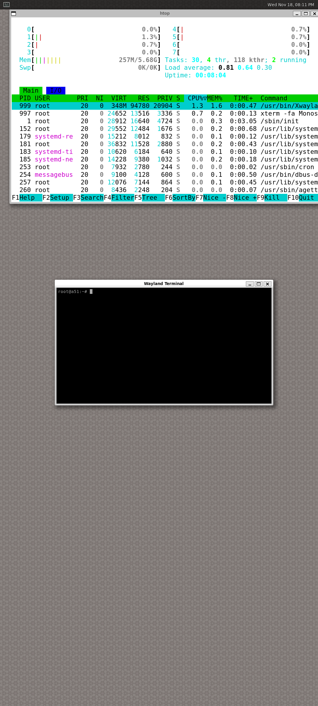

# Linux on the Samsung Galaxy A51 (SM-A515F)

Mainline Linux support for the Samsung Galaxy A51, an Exynos 9611 phone.
It boots into a full GPU-composited desktop: the kernel owns the display
controller, the MIPI link and the AMOLED panel, the Mali-G72 runs under
panfrost, and touchscreen, thermal sensors and the charger are all driven by
mainline drivers.  Wi-Fi station mode works as well, including WPA3, and
the same block now carries a working Bluetooth HCI transport.



*Weston with Xwayland: `htop` is an X11 client, the window next to it is a
native Wayland one, both composited on the GPU at 60 fps on the 1080x2400
panel.*

## Screenshots

| Sway | Phosh |
|---|---|
|  |  |
| *Sway tiling `foot` next to `glmark2`, rendering a textured scene on the Mali-G72 through panfrost.* | *Phosh on the phone, with the blurred, translucent shell drawn by the GPU.* |


## Hardware

| | |
|---|---|
| SoC | Samsung Exynos 9611: 4x Cortex-A53 + 4x Cortex-A73, Mali-G72 MP3 |
| RAM | 6 GB |
| Display | 6.5" 1080x2400 AMOLED (Samsung EA8076), MIPI DSI, command mode |
| Storage | UFS (Android), microSD |
| Wi-Fi/Bluetooth | Samsung SCSC ("mx140") over HIP4, 2.4 and 5 GHz |
| Power | Samsung SM5713 charger, fuel gauge and MUIC, S2MPU09 PMIC |
| Input | Melfas mss100 touchscreen, GPIO keys |

## Status

Working:

- **Display** - DECON/IDMA/DPP scanout, DSIM host and D-PHY, panel bridge,
  brightness, DPMS, s2idle. 60 fps with vblank-driven page flips.
- **GPU** - panfrost on the Mali-G72, with a g3d power domain that gates the
  GPU through the vendor PMU sequences and TZPC SMC.
- **Touchscreen and keys** - mss100 multi-touch, power and volume keys.
- **Thermal** - Exynos 9610 TMU with eFuse trim calibration, three zones.
- **Charger** - input current limit, fast-charge current, float voltage and a
  charge-stop threshold with hysteresis.
- **USB** - DWC3 peripheral mode, used here as an ECM gadget (the root
  filesystem runs over it).
- **Storage** - microSD in non-UHS 50 MHz high-speed mode, UFS.
- **Wi-Fi** - station mode on 2.4 and 5 GHz, WPA2-PSK and WPA3-SAE, DHCP,
  and a join at boot with a saved connection.  ~90 Mbps on the LAN,
  ~47 Mbps down and 36-42 Mbps up to the internet.
- **Bluetooth** - BSMHCP HCI transport, LE and BR/EDR discovery, LE
  advertising and ACL data.  BlueZ powers the adapter at boot; no manual
  `hciconfig` step is needed.
- **Desktops** - Weston with Xwayland, Sway, Phosh and KDE Plasma Mobile all
  render on the panel.

Not supported yet:

- **CPU frequency scaling** - the ACPM firmware does not service the DVFS
  channel, so the cores stay at their boot rate. This is the main reason heavy
  workloads feel slow.
- **CPU idle / deep sleep** - needs the PMUCAL core power down/up sequences;
  only s2idle works.
- **GPU DVFS** - no OPP table and no `mali-supply`, so the GPU clock is fixed.
- **USB host / OTG** - the controller is fixed to peripheral mode. The boost
  and MUIC switching are in place, the role switch is not wired up yet.
- Audio (ABOX), cameras, modem and NFC - untouched subsystems.  Bluetooth
  audio (SCO/AVDTP) is also not implemented yet.

## Wi-Fi

The A51 has no SDIO or PCIe wireless interface: Wi-Fi and Bluetooth sit
behind Samsung's SCSC ("mx140") block, which the host drives through a HIP4
queue pair in DRAM and a mailbox.  `CONFIG_EXYNOS9610_WLBT` builds
`exynos9610-wlbt.ko` from six translation units under
`drivers/soc/samsung/` (core, HIP4, MLME, debugfs, netdev and BT).

On this port the module copies the firmware into the peer's MIF window
itself, so `load_firmware=1` is required.  The three files the module asks
for have to be in place (they come from the vendor partition):

```sh
install -D -m 0644 mx140.bin          /lib/firmware/mx140/mx140.bin
install -D -m 0644 mx140_wlan.hcf     /lib/firmware/mx140/mx140_wlan.hcf
install -D -m 0644 mx140_wlan_sw.hcf  /lib/firmware/mx140/mx140_wlan_sw.hcf
```

and the module has to be told to load them:

```sh
# /etc/modprobe.d/wlbt.conf
options exynos9610_wlbt send_pmk=0 eapol_mlme=1 rx_chain_frame=1 load_firmware=1 sae_support=1
```

`send_pmk=0` keeps the four-way handshake in the supplicant: the peer's
`SET_PMK` path can reset its firmware.  `eapol_mlme=1` is the EAPOL path that
gets message 2 past the peer's key gate, and `rx_chain_frame=1` takes a frame
out of a received chain (needed for the SAE indications).  `sae_support` is
off at boot because advertising WPA3 changes what the peer does on every
boot, and one failed join would then repeat forever.  WPA2 does not need it;
turn it on for a WPA3 network.

Measured on the SM-A515F with 6.18.58, against a 5 GHz access point on
channel 64:

| test | result |
| --- | --- |
| `wpa_cli -i wlan0 status` | `wpa_state=COMPLETED`, `key_mgmt=SAE`, `mgmt_group_cipher=BIP` |
| DHCP address | `192.168.100.78/24` |
| ping | 33-36 ms |
| LAN download | 10-11.5 MB/s (~90 Mbps) |
| internet download | ~47 Mbps |
| internet upload | 36-42 Mbps |
| kernel log during a bulk transfer | 0 lines |
| cold boot | joins with a saved connection, 0 firmware resets |

Throughput was measured with `curl --interface wlan0` against a host HTTP
server on the LAN and against an internet speed-test endpoint; the USB
gadget carries the root filesystem, so naming the interface matters.

For WPA3, the access point used here never answers the SAE H2E exchange;
`sae_pwe=0` (hunting-and-pecking) is what completes:

```ini
# /etc/wpa_supplicant/wpa_supplicant-wlan0.conf
sae_pwe=0
network={
        ssid="..."
        psk="..."
        key_mgmt=SAE
        ieee80211w=1
}
```

WPA2-PSK uses the same driver with `key_mgmt=WPA-PSK` and no `sae_pwe`.

Limitations:

- If the first join after boot does not finish within about a minute, the
  firmware can assert its watchdog and stop.  A warm reboot leaves the
  companion in that state; a cold boot clears it.
- Only station mode has been exercised.

## Bluetooth

Bluetooth is a separate SCSC service (`SCSC_SERVICE_ID_BT = 2`), not an HCI
UART or a HIP4 queue.  `wlbt-bt.c` starts that service through the
service-management channel, lays out the BHCS and BSMHCP shared-memory block,
and registers a virtual HCI device.  Command, event and ACL rings are bridged
to the HCI core; ACL TX buffers are reclaimed from the BSMHCP free ring and
turned into Number Of Completed Packets credits.

The firmware file is `mx140/mx140_bt.hcf` and must be next to the Wi-Fi
firmware.  `CONFIG_BT=m`, `CONFIG_BT_BREDR=y` and `CONFIG_BT_LE=y` are
enabled; `exynos9610_wlbt` then depends on `bluetooth.ko`,
`ecdh_generic.ko` and `ecc.ko`.  All are installed in the rootfs module
tree, and `/etc/modules-load.d/wlbt.conf` loads the transport at boot.

Verified on the SM-A515F:

| test | result |
| --- | --- |
| `hciconfig -a` | `UP RUNNING`, HCI 5.0, manufacturer 117 (Samsung) |
| `bluetoothctl --timeout 5 scan on` | LE advertisers and the Samsung TV over BR/EDR |
| `bluetoothctl advertise on` | one active advertising instance |
| host Intel controller | connected to the advertisement and exchanged ACL packets |
| `bluetoothctl power off` / `power on` | adapter returns to `UP RUNNING` |

Limitations:

- The address is still the placeholder `00:11:22:33:44:55`; it should come
  from the SoC unique ID or the Android `bt_addr` file.
- SCO/AVDTP audio, vendor-specific HCI commands and a sustained 30-buffer ACL
  transfer are not implemented or not yet exercised.
- Pairing and a long-lived LE connection are not yet validated end to end.

## Building

```sh
export CROSS_COMPILE=aarch64-linux-gnu-
make ARCH=arm64 exynos9611_a51_defconfig
make ARCH=arm64 -j$(nproc) Image dtbs modules
```

The device tree is `arch/arm64/boot/dts/exynos/exynos9611-a51.dts`; the shared
SoC description is `exynos9611.dtsi` next to it.

## Booting

The boot chain is the stock Samsung one, kept intact: the vendor bootloader
sets up the panel link, and the `uniLoader` payload then starts the kernel.
Flashing only touches the `boot` partition - the Android installation on the
other partitions stays untouched.

Short version:

```sh
# uniLoader is the small payload that starts the kernel from the stock
# bootloader; build it from its own repository.
make ARCH=aarch64 CROSS_COMPILE=aarch64-linux-gnu-   # in uniLoader

magiskboot repack boot.img new-boot.img   # Image + dtb + uniLoader
dd if=new-boot.img of=/dev/block/by-name/boot bs=1M conv=fsync
```

## Notes on the port

Some parts of this SoC are fenced off by secure firmware, and the drivers
reflect what could be verified on hardware rather than what the vendor kernel
does:

- Power domains, DVFS and CPU idle go through the ACPM firmware interface on a
  shared mailbox; the mailbox and ACPM transports are ported, but the firmware
  only services the channels it already knows about.
- The display pipeline is driven by frame-done interrupts rather than the
  panel's tearing effect, which the panel never emits on this board.
- Shadow register updates are posted asynchronously. Waiting for the pipe to
  drain them inside the commit path delayed every flip event by one frame,
  which pinned vsynced compositors to half the panel refresh rate.

## Credits

Built on the work of the mainline Linux community, and on the vendor kernel
sources shipped by Samsung for the reference register layouts, PMU sequences
and firmware protocols.
